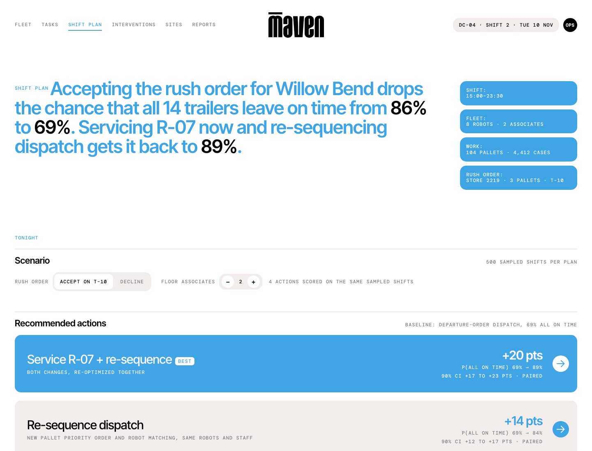

# Shift Plan: trailer cutoff risk for a Maven fleet (concept)

**Live demo:** https://mohith26.github.io/maven-robotics-shift-plan/

An unofficial concept feature for Maven Robotics' fleet software, built by Mohith Gajjela. Not affiliated with Maven Robotics. All data is synthetic.



## What it is

Maven's robots build mixed-case store pallets in a distribution center: orders come in from the customer's WMS on one side, and product leaves on trucks on the other. The hard deadline in that loop is the trailer departure. A store can change its order within 48 hours of delivery, and a rush add-on at 15:00 raises a real question for the shift lead: if we accept this, which trucks are now at risk, and what is the cheapest way to protect them?

Shift Plan answers that question with numbers:

- **Cutoff risk per trailer.** The chance each of tonight's 14 trailers is loaded before departure, with an 80% band for its ready time.
- **Ranked actions.** Re-sequencing dispatch, servicing a robot whose pick reliability has drifted, adding a floor associate, or combinations, each scored by how much it changes the chance that *every* trailer leaves on time, with a 90% interval on that change.
- **Evidence.** How well the forecasts have held up on past shifts, and which robots need help more often than the fleet.

On the demo night (104 pallets, 4,412 cases, 8 robots, 2 associates) accepting a 3-pallet rush order drops the chance that all 14 trailers leave on time from **86% to 69%**. Servicing R-07 at 15:00 and re-sequencing dispatch brings it back to **89%** (paired improvement +20 points, 90% CI +17 to +23).

## How it works

1. **Pick model from fleet logs** (`core/shiftplan.js: fitModel`). 119,466 logged picks from 30 past shifts. Log cycle time is regressed on case features (distance from pick face, weight, placement height on the pallet, pack type). Residual moments are kept per pack type, so retries and other non-Gaussian behavior are carried into pallet-level means and variances. A shift-level random effect (method of moments on per-shift mean residuals) captures slowdowns that hit every robot at once.
2. **Interventions** (a robot needs a person to clear a failed pick) are a logistic regression on the same features, with per-robot multipliers estimated by empirical-Bayes Gamma-Poisson shrinkage (alternated with the logistic fit). R-07 comes out at 2.2x a typical robot (90% interval 2.05-2.40); every other robot's interval overlaps 1.
3. **Scenarios with common random numbers** (`makeScenarios`). Each sampled shift draws one shift effect, and for each pallet a work-time draw, a Poisson intervention count (inverse CDF of a shared uniform, so it is monotone in the robot's multiplier), intervention offsets, associate walk times and fix times from the logged empirical distributions. Every policy and action is scored on the same draws, so differences are paired.
4. **Discrete-event simulation** (`simulate`). Robots pull the next pallet from a priority list when they free up. Interventions queue FIFO for a shared pool of floor associates, so a robot waits while someone else's fix is in progress. A trailer is ready when its last pallet is done plus 15 minutes of loading.
5. **Calibration** (`core/pipeline.js: calibrate`). A spread multiplier on the scenario noise is chosen on 30 held-out calibration shifts so that 80% ready-time bands cover 80% of trailers, then checked on 30 later shifts it never saw: **78% coverage on 384 trailers**, versus **48%** for a model that treats picks as independent (it misses shift-wide slowdowns and is badly overconfident).
6. **Dispatch optimization** (`optimize`). Sample average approximation over 100 scenarios: local search over the pallet priority list (relocate, swap, move a trailer's block) plus flags that keep a degraded robot off the riskiest pallets, minimizing expected late trailers. Results are always re-scored on 500 fresh scenarios so the reported gain is out of sample.
7. **Actions** (`rankActions`). Each option is re-planned and scored against the departure-order baseline on the same 500 scenarios; the page reports P(all on time) and a paired 90% interval on the change.

## Tests

```
node --test tests/shiftplan.test.mjs
```

12 tests: RNG and Poisson inverse CDF properties, the linear-algebra and quantile helpers, simulator invariants (one robot reduces to cumulative sums; one associate queues two simultaneous interventions FIFO; degraded robots skip avoided pallets), model recovery (only R-07 is flagged and its interval contains the true relative multiplier; the shift effect is within 30% of truth), common random numbers (identical policies give exactly zero paired difference; servicing a robot never adds interventions), the optimizer beating EDD in sample and on fresh scenarios, calibration (test coverage between 70% and 90%, naive below 60%), a ground-truth check (the optimized plan also wins under the hidden site physics in `data/truth.mjs`), and data integrity.

## Data

`node data/generate.mjs` regenerates everything from a fixed seed: a 169-SKU catalog of generic CPG cases (drinks in shrink trays, cereal, detergent, paper towels in poly bundles, pet food bags), 46 stores, 90 past shifts and tonight's orders. The generator uses a richer "true" site model than the planner (per-case lognormal noise, per-case retries, Bernoulli interventions, R-07 with worn grippers, a hidden shift effect). The planner only sees the logs.

Ground-truth check (400 simulated nights under the hidden physics, rush order accepted): departure-order dispatch 75%, re-sequence 87%, service R-07 80%, add an associate 81%, service + re-sequence 91% of nights with every trailer on time. The model is slightly pessimistic compared with the truth, and it ranks "add an associate" and "service R-07" in a different order from the truth on the no-rush night.

## Limitations

- Synthetic data. The site, the numbers and the robot behavior are invented, calibrated only to public facts (8 robots, 16-hour days, mixed-case palletizing, 30 kg payload).
- The baseline "departure-order dispatch" is my guess at a sensible current policy, not Maven's actual dispatcher.
- No travel congestion, no battery swaps, no pallet-build sequencing constraints beyond heavy-first stacking, no forklift or dock-door limits.
- The service action assumes a 20-minute fix restores typical reliability. In reality the cause of R-07's interventions would need to be diagnosed first.
- Calibration is marginal over trailers and was done under departure-order dispatch; using it for the optimized plan assumes the error structure transfers.
- The forecast is made at 15:00 and not updated during the shift. An obvious next step is to update the shift effect online from the first hour of picks.

## Novelty note

I could not find this feature in Maven's public material (site, careers pages, launch coverage, investor memo) or in the public product pages of mixed-case palletizing vendors I checked (Mujin, Jacobi, Viroteq, Swisslog). Those describe pallet pattern generation, motion planning and real-time orchestration, not calibrated trailer-cutoff risk or ranked, uncertainty-quantified recovery actions. The closest thing I found is Locus Robotics (AMR picking, a different product category), whose LocusHub advertises "predictive insights for work completion" and "capacity risk"; I found no public description of calibrated per-trailer probabilities, coverage checked on held-out shifts, or recovery actions ranked by a paired effect with an interval. Warehouse execution systems plan waves against carrier cutoffs deterministically.

Design tokens come from careers.mavenrobotics.ai (Inter Tight and DM Mono are Maven's own free stand-ins for its licensed fonts). There are no public screenshots of Maven's fleet software, so the app shell follows Maven's web design system.
